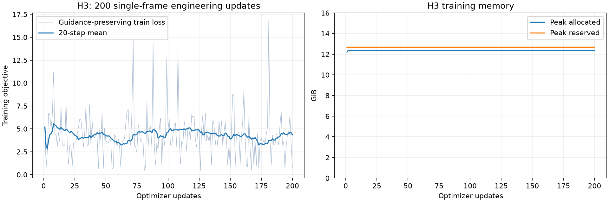

# MiniMax H3: the completed 200-step single-frame LoRA experiment

These are the scripts used to train a LoRA on the FenomAI MiniMax-H3 NVFP4
checkpoint for **200 updates on an RTX 5060 Ti 16 GB**. The experiment uses one
512×512 frame and a silent audio target. It exercised native FP4 forward and
backward GEMMs, software stochastic rounding, H128 random Hadamard transforms,
checkpointing and optimizer-state resume.

The H3 runtime, objective, optimizer, attention selection and defaults are
preserved. The published copy changes source/asset path discovery and imports
the same shared CUDA kernels from this repository. It adds preparation and
readiness instructions; it does not replace the existing full-parameter or LoRA
interfaces. [Packaging checks](packaging-checks.json) record the source comparison.

This is a **single-frame LoRA engineering experiment** using a Ref2VA checkpoint
without reference input. It has not established a working character or video
fine-tuning recipe. The completed subject-learning demonstration uses
[FLUX.2 Klein](../flux2_klein/README.md).

## Recorded result

| Measurement | Recorded value |
|---|---:|
| Completed updates | 200: a 12-step pilot, then resume to 200 |
| Trainable parameters | 22,364,160 |
| Resumed segment median update | 0.9707 s |
| Peak allocated memory | approximately 12.38 GiB |
| Heldout guidance-preserving MSE, step 0 → 200 | 4.71838 → 4.59948 |
| Heldout plain flow MSE, step 0 → 200 | 0.302323 → 0.302022 |

Update timing includes forward, objective, backward, clipping and fused AdamW.
The reported median omits the resumed segment's first three updates and excludes
loading, validation, saving and sampling. It is the original run statistic, not
a new multi-round benchmark. Frozen tensors passed the run's version-counter
checks. Validation uses the **first four of eight heldout images**, each at two
fixed noise levels/seeds. These losses are not video-quality or identity scores.



[Raw training records](../../results/lora-image/h3-training.json) ·
[Optimization history and probes](../../results/lora-image/README.md#minimax-h3-what-was-tested) ·
[Exact recorded sessions and original code hashes](recorded-run.json)

## Software and inputs

The completed run used Windows, Python 3.11, PyTorch **2.14.1+cu132**, CUDA runtime
13.2 and an SM120 GPU. The packed path needs the public
`torch.nn.functional.scaled_mm` API and NVRTC. The full-training package's older
TorchAO/Triton environment is not the environment used by this H3 example.

Recorded supporting versions:

| Package | Version |
|---|---|
| transformers / diffusers / accelerate | 5.16.1 / 0.40.0 / 1.14.0 |
| safetensors / einops | 0.8.0 / 0.8.2 |
| numpy / pillow | 2.4.6 / 12.3.0 |
| av / pyarrow / toml / voluptuous | 17.1.0 / 23.0.1 / 0.10.2 / 0.15.2 |

Use an environment with this stack already available. The example performs no
package upgrades and imports `precision_lora` directly from the repository's
`src` directory. `huggingface_hub`, `requests` and Git are also used during input
preparation. `check_setup.py` reports the installed versions. On the original
machine, the four packages in the final row were supplied in a project-local
`deps` directory; `H3_LOCAL_DEPS` can select an existing such directory.

The model implementation is an external, pinned musubi-tuner checkout. Only its
source is imported: do not install its whole requirements list over a working
training environment. The example's model weights, dataset and musubi source
retain their upstream licenses. [sources.json](sources.json) contains repository
revisions, required filenames and SHA256 values. Model weights and data are not
included in the Git repository or backup source package.

## Prepare a separate work directory

Run the commands below from this example directory. Use an empty work directory
for a new reproduction. `H3_EXPERIMENT_ROOT` defaults to `workdir` beside the
scripts; it contains downloads, caches and results, and is ignored by Git.

For PowerShell, an explicit location and Python selection look like:

```powershell
$env:H3_EXPERIMENT_ROOT = 'D:\h3-single-frame-work'
$env:H3_PYTHON = 'C:\path\to\verified-python\python.exe'
# run-h3.cmd uses this Python without changing PATH or installing anything.
.\run-h3.cmd download_inputs.py
```

On Linux, set `export H3_EXPERIMENT_ROOT=/path/to/h3-single-frame-work` and use
the selected environment's `python`. The commands below use `python` as shorthand
for that interpreter; on Windows, `run-h3.cmd` is an alternative wrapper.
The 200-step result was measured on Windows; this packaging pass did not run an
H3 training job on Linux.

1. Prepare the work directory and fetch the pinned dataset/processor files:

   ```bash
   python download_inputs.py
   ```

2. Clone musubi into `<workdir>/upstream/musubi-tuner` and select the recorded
   revision. Create `<workdir>/upstream` first. Alternatively, set
   `H3_MUSUBI_ROOT` to an existing checkout at this revision.

   ```bash
   git clone https://github.com/kohya-ss/musubi-tuner <workdir>/upstream/musubi-tuner
   git -C <workdir>/upstream/musubi-tuner checkout f8a1b03794a49239a3539015075f5123d6c07d66
   ```

3. Download the four weight files, about **34.03 GB** total. This is the original
   resumable 8 MiB range downloader. It verifies each range and the assembled
   SHA256, retains valid parts on failure, and stops after bounded retries.
   Allow extra disk space for a file's parts and assembled copy during download.

   ```bash
   python download_parts.py --workers 12
   ```

4. Build the original seeded dataset split and caches. Text preparation swaps
   20 encoder blocks; this happens before training, not inside timed updates.

   ```bash
   python prepare_dataset.py
   python cache_inputs.py latents
   python cache_inputs.py text --text-blocks-to-swap 20
   python check_setup.py
   ```

Stop on an error before proceeding. `check_setup.py` checks source revision,
weight sizes, exact recipe/manifest hashes, cached inputs, imports and SM120
availability without training. Add `--verify-model-hashes` to reread all weight
bytes; `download_parts.py` already checks those hashes during download.

The data is `diffusers/tuxemon`: seed 20261109 selects 32 training and eight
heldout images. The images are resized/padded to 512px. Prompts and latent/text
caches are generated by the included scripts. They form part of this recipe;
use a separate work directory when changing the dataset or prompts.

## Reproduce the two training sessions

The original output label was `nvfp4-main`. The commands below deliberately use
a **new** label, `h3-reproduction`, so existing experiment results are preserved.
Choose another unused label if that directory already exists. Run each command
in the foreground and proceed only after it succeeds.

```bash
python experiment.py pilot --mode nvfp4 --out h3-reproduction --max-steps 12 --schedule-steps 800 --rank 8 --first-block 20 --lr 1e-4 --backward-cache-gib 0 --attention efficient-deterministic
python experiment.py train --mode nvfp4 --out h3-reproduction --resume --max-steps 200 --schedule-steps 800 --rank 8 --first-block 20 --lr 1e-4 --backward-cache-gib 0 --attention efficient-deterministic
```

Keep **`--schedule-steps 800`**, even though the run stops at 200. The recorded run
uses a 50-step warmup and an 800-step cosine schedule with a 0.1 floor. Changing
the schedule to 200 would change the trained experiment. `--max-steps` is the
total target step, not an additional number of updates. To resume an interrupted
run, retain its output label and recipe and use `--resume`; the target must be
greater than the saved step. A completed 200-step directory is already finished.

The preserved recipe uses rank/alpha 8, adapters on quantized linear layers in
blocks 20–49, FP32 adapter parameters, BF16 adapter compute and fused AdamW
(`betas=(0.9,0.999)`, `eps=1e-8`, zero weight decay, clip norm 1). Checkpointing is
enabled. Deterministic efficient attention is selected explicitly. There is no
backward-weight cache: transpose, H128 RHT and quantization are recomputed on GPU.

The objective follows the experiment's guidance-preserving construction for the
distilled base. Above noise level 0.15 it uses
`unconditional + 4 * (flow_target - unconditional)`; otherwise it uses the flow
target directly. The unconditional prediction is evaluated without gradients.
Video/audio shifts are 1/3. This is preserved as run, not replaced by the later
FLUX DreamBooth objective.

## Outputs and modes

Results are written to `<workdir>/results/<out>/`:

- `run.jsonl`: configuration, source hashes, every update, memory, validation and timing.
- `last.pt`: adapter, optimizer and resume state, including stochastic-rounding counters.
- `lora-step-0200.safetensors`: the exported adapter with rank/alpha, base revision
  and one-frame metadata. The export uses musubi naming; compatibility with other
  loaders is not established by this run.
- `step-0200/sample-*.pt`: generated latents for the six original probes.

Decode saved latents separately, using the full path to the chosen output:

```bash
python cache_inputs.py decode --source /absolute/path/to/workdir/results/h3-reproduction
```

`--checkpoint-path` restores an adapter for sampling; use `--resume` when
continuing optimizer updates. The original scripts retain three diagnostic mode
names, which are local to this example:

| H3 mode | Frozen-base forward | Input-gradient backward |
|---|---|---|
| `nvfp4` (the 200-step run) | Native FP4 | Native FP4 with H128 RHT and SR |
| `native` | Native FP4 | BF16 after decoding the existing FP4 weights |
| `preserve` | BF16 after decoding the existing FP4 weights | BF16 from those decoded weights |

The latter two are diagnostic controls, not additional completed 200-step runs.
Their source weights remain the quantized H3 checkpoint: `preserve` here does
not recover pre-quantization BF16 weights and is distinct from the generic
`precision_lora` mode with that name.

The original work directory, weights and checkpoint can be reused by setting
`H3_EXPERIMENT_ROOT` to it and running `check_setup.py`; no recaching or retraining
is necessary for inspection. Keep its completed output label untouched.
