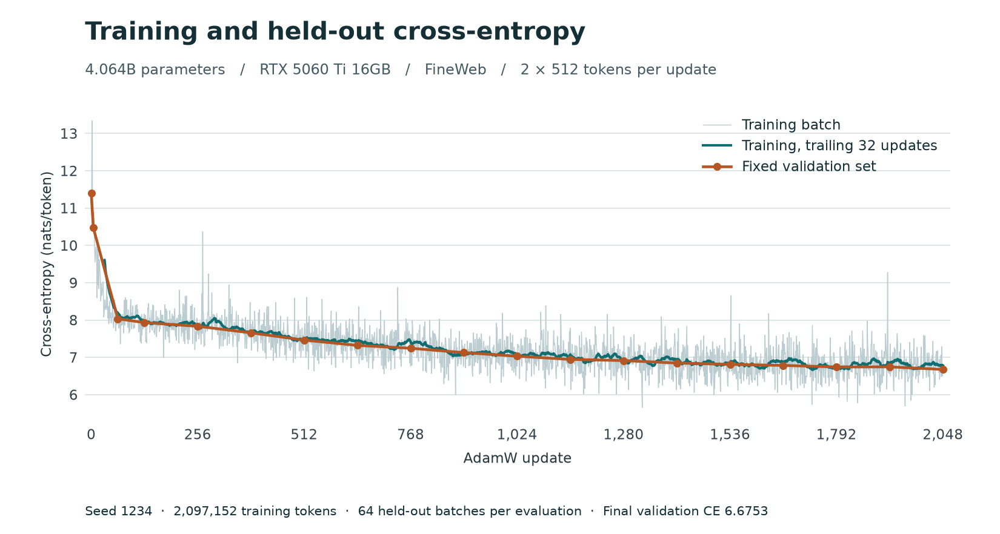
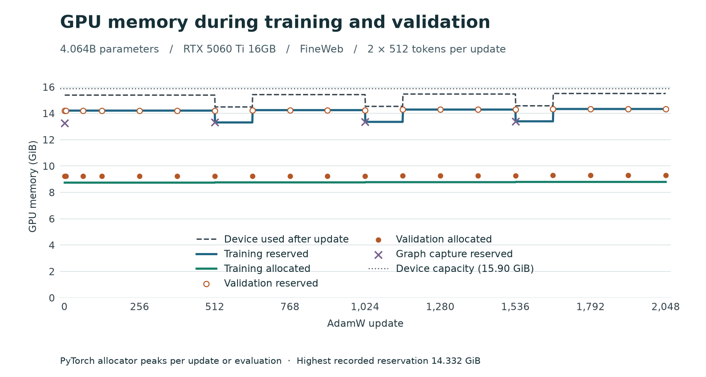

# 4.06B full-parameter training on a 16 GB RTX 5060 Ti

A 50-layer causal Transformer ran 2,048 full-parameter AdamW updates on 2,097,152 FineWeb tokens. Weights, activations and optimizer state stayed on one GPU. Validation cross-entropy fell from **11.40081 to 6.67528 nats/token**.



| Update | Validation CE (nats/token) |
|---:|---:|
| 0 | 11.40081 |
| 64 | 8.03213 |
| 256 | 7.83258 |
| 512 | 7.46115 |
| 1,024 | 7.02965 |
| 1,536 | 6.81008 |
| 2,048 | 6.67528 |

The gray line shows the loss for each training batch. The teal line averages the last 32 updates. The orange points use the same 64 held-out batches at every evaluation (65,536 target tokens). Training loss averaged 9.6050 over the first 32 updates and 6.7815 over the last 32. This is one run from random initialization, with seed 1234.

## GPU memory and update time



| Phase | Peak PyTorch allocated (GiB) | Peak PyTorch reserved (GiB) |
|---|---:|---:|
| Graph capture | 12.748 | 13.396 |
| Training replay | 8.795 | 14.332 |
| Validation | 9.287 | 14.332 |
| Highest recorded, including initialization | **12.748** | **14.332** |

CUDA Graph captures temporary allocations up front and reuses those addresses on replay. The graph pool remains reserved during validation. The dashed line shows total device memory in use after each update, from CUDA's free-memory counter. It includes driver and other device allocations and ranged from 14.49 to 15.51 GiB. Checkpoint I/O and the final diagnostic scan are outside the phase measurements.

Mean training time was **297.98 ms/update** (3,436 tokens/s). Each timed update includes the input copy, forward pass, loss, backward pass, AdamW step and synchronization to read the loss. Compilation, capture, validation, memory sampling and checkpoint writes are excluded.

## Model and training setup

- 4,063,797,760 trainable parameters, width 2,560, 50 layers, 40 attention heads, MLP width 10,240 and a 50,257-token vocabulary. The input embedding and output head share one FP32 weight.
- Batch size 2, sequence length 512. The run uses the first 2,048 batches from the same seeded 8,192-batch schedule used in the [five-step capacity test](../capacity-4b.json). The recorded hashes identify the shard and the full training and validation window schedules.
- `experimental_fp8_master` profile, block-by-block initialization, transpose recomputation, scaled FP8 projection weights, two 4-bit AdamW moments, native FP4 matrix multiplication, software stochastic rounding and H16 random Hadamard transforms.
- AdamW with a fixed learning rate of 0.0001, betas (0.9, 0.999), epsilon 1e-8 and weight decay 0.01. All trainable parameters participate. The graph captures recorded 603 native FP4 matrix multiplications and 402 stochastic-rounding calls per update.
- Training uses tiled cross-entropy. Validation uses FP32 cross-entropy on disjoint held-out tokens. The CUDA graph closes every 512 updates to save a local checkpoint, then resumes with the same optimizer and SR counters.
- Single GeForce RTX 5060 Ti 16GB, WSL2 Ubuntu 22.04, PyTorch 2.11.0+cu130, CUDA Toolkit 13.0, TorchAO 0.17.0 and Triton 3.6.0. Training code: [`0.1.0.dev1` at 12ed9f8](https://github.com/xl03-bit/sm120-nvfp4-training/tree/12ed9f83dca4baa377a149b9733a6655c8ca38f4).

## The first run and the FP8 fix

The [original implementation](https://github.com/xl03-bit/sm120-nvfp4-training/tree/74fab229fe8931c4c2a04e55daf85e85440101f1) used a fixed power-of-two storage scale per projection. Its E4M3 encoder wrote a NaN when an updated weight exceeded the finite range of that scale. At update 1,024 we found three FP8 NaNs in the MLP output weights of blocks 39 and 42 (zero-based). By update 2,048 there were 255 FP8 NaNs across 55 projections. The last 32 training losses still averaged 6.7682. The final full-tensor check rejected that checkpoint.

Re-evaluating the frozen step-1,024 checkpoint on the same 64 held-out batches gave CE 10.82491. Both affected projections produced a NaN when recomputing their weight scale. Substituting only their finite optimizer-cached scales gave CE 6.96550 with the same weights. The training graph reuses optimizer scales, which explains how its reported loss could stay finite. [Diagnostic measurements](initial-run-diagnosis.json)

The updated kernel keeps a power-of-two unit per 512 weights. When a finite FP32 AdamW update exceeds a block's E4M3 range, the kernel increases that block's unit before stochastic FP8 encoding. Other blocks retain their scale. The scale storage costs about 0.008 bytes per FP8 weight. The rerun started from the same seed, reproduced the initial validation loss and consumed the same training and validation windows. At the final update, 157 of 7,680,000 blocks had grown relative to their initial unit. Every evaluation scanned all FP8 master weights and the final check covered model parameters, buffers and floating optimizer states. The [range regression](../../tests/test_fp8_master_range.py) covers forced overflow, both FP4 packing directions and scalar-checkpoint migration. The [profile checks](profile-checks.json) cover aligned and padded shapes and checkpoint continuation in all six modes.

## Reproduce

Install the package and run the GPU verification as described in the [project README](../../README.md). Point `NVFP4_FINEWEB` at the specified GPT-2-tokenized shard. Run the following from the repository root, with at least 14.4 GiB of GPU memory free and 20 GiB of disk space available. The output directory stores the logs and the latest checkpoint.

```bash
python results/fineweb-4b-2048/train.py --output ./run-4b
python results/fineweb-4b-2048/plot.py ./run-4b/metrics.json ./run-4b
```

After an interruption, pass `--resume` with the same output path to continue from the last committed checkpoint. Rendering the plots requires NumPy and Matplotlib.

[Per-update CSV](training.csv) · [Validation CSV](validation.csv) · [Full metrics, including per-batch validation and memory in bytes](metrics.json) · [Summary](summary.json)
