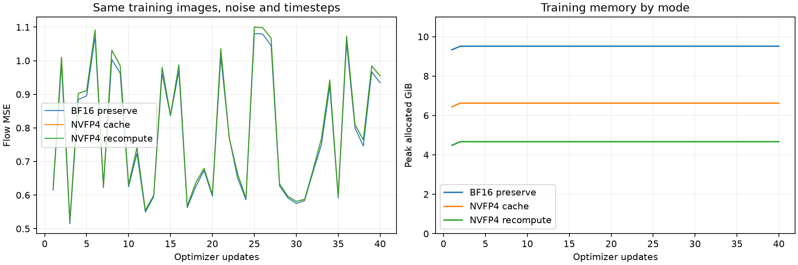
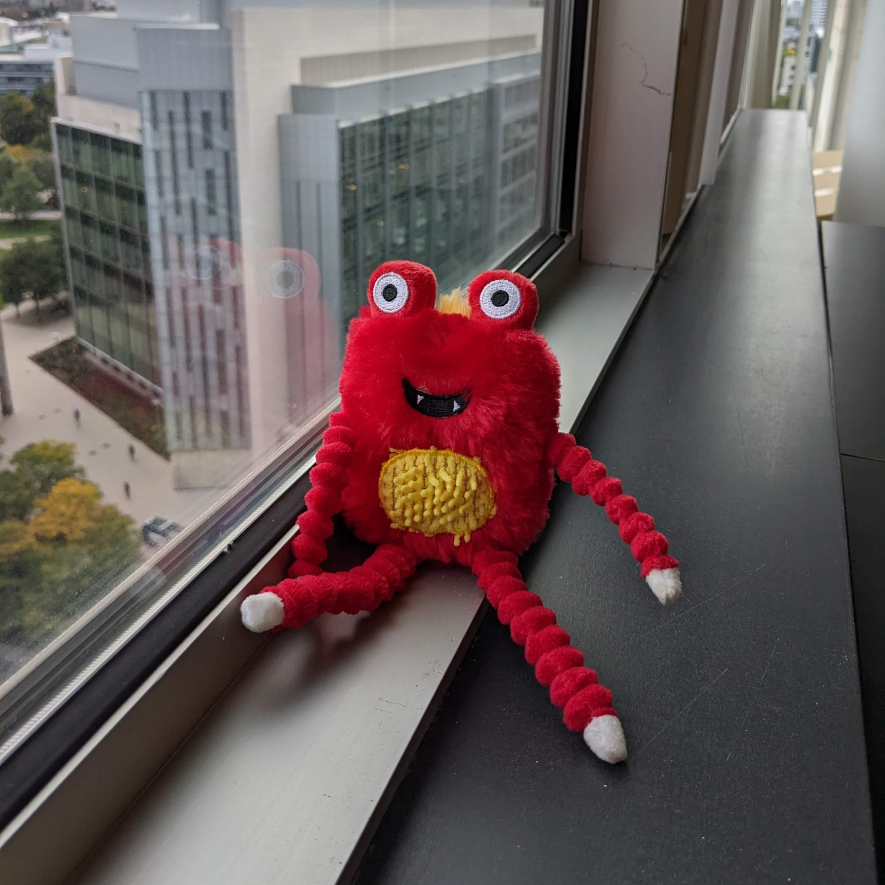
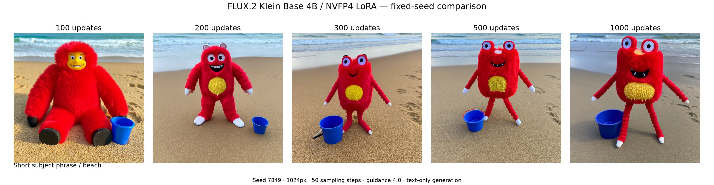
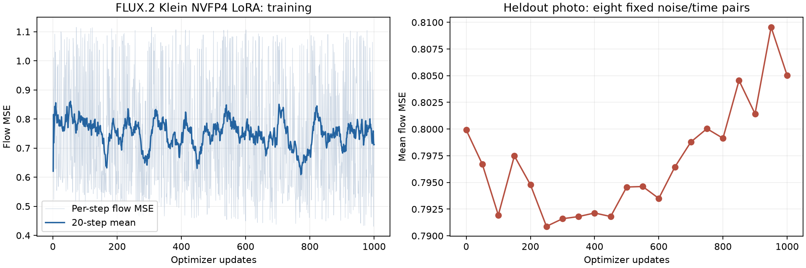
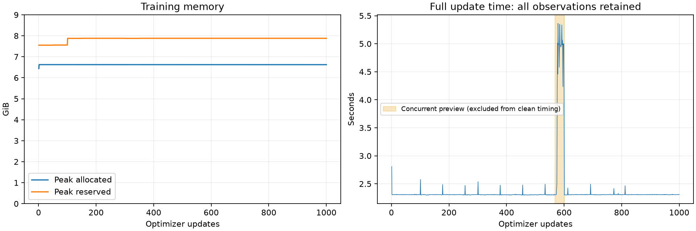
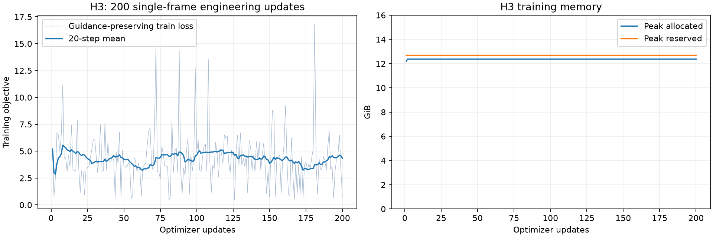

# Native NVFP4 LoRA: image-model results and H3 engineering tests

FLUX.2 Klein Base 4B completed **1,000 LoRA updates at 1024×1024 on one RTX 5060 Ti 16 GB**. The frozen base runs native FP4 Tensor Core GEMMs in forward and backward; backward uses software stochastic rounding and H128 random Hadamard transforms. Both LoRA matrices train in BF16 compute with FP32 parameters and AdamW state.

## Matched full-step performance

Windows, PyTorch 2.14.1+cu132, batch 1, rank/alpha 16, 98 projections, 23,887,872 trainable parameters, block checkpointing, cuDNN attention, lr 1e-4, clip norm 1. Each mode uses the same four cached photographs, captions, adapter initialization, timestep sequence and noise seeds. Forty real updates: ten warmups followed by three groups of ten synchronized measurements. Timing includes forward, loss, backward, clipping and fused AdamW; it excludes loading, compilation, caching and validation.

| Mode | Mean s/update | Images/s | Speed vs BF16 | Peak allocated GiB | Peak reserved GiB | Heldout MSE at 0 / 40 |
|---|---:|---:|---:|---:|---:|---:|
| BF16 `preserve` | 3.405 | 0.294 | 1.00× | 9.516 | 10.242 | 0.787353 / 0.785813 |
| `packed_nvfp4`, cache | 2.306 | 0.434 | 1.48× | 6.626 | 7.553 | 0.799910 / 0.796852 |
| `packed_nvfp4`, recompute | 2.360 | 0.424 | 1.44× | 4.669 | 5.809 | 0.799910 / 0.797351 |

Cache reduces training peak allocation by **30.4%** versus BF16. Recompute reduces it by **50.9%**, giving up about **2.4%** speed versus cache. Original BF16 transformer weights alone occupy 7.219 GiB; selected FP4 projections need about 0.5625 bytes/weight with recomputation, or 1.125 with a cached backward orientation. Total memory also includes untargeted weights, adapters, optimizer state and activations.

The BF16 and official NVFP4 checkpoints are separate representations of the base model; their initial losses already differ. cuDNN attention is not bitwise deterministic, so identical seeds do not make independently trained cache/recompute traces identical. Their operators, SR sequences and updates agree bitwise under the deterministic test configuration. These 40-step traces are a performance and stability comparison, not a long-run quality comparison.

Raw settings, round means and every step are in [benchmark/](benchmark/). [The runnable example](../../examples/flux2_klein/README.md) reproduces loading, caching, training, inference, export and measurement. The older floating-base `nvfp4` mode has separate [453M and GPT-2 results](../lora/README.md); it uses a different quantization recipe and is not substituted for this checkpoint in the table.

## Learning one subject over 1,000 updates

The subject is Google DreamBooth's `monster_toy`: four training photographs and one heldout photograph. The recipe follows the public Diffusers FLUX.2 Klein DreamBooth example: flow matching, frozen text encoder/VAE, original scheduler, no caption dropout or prior-preservation images. Training latents retain the original FP32 VAE normalization statistics. The public recipe, dataset hashes and pinned revisions are recorded in [flux-protocol.json](flux-protocol.json) and [subject-sources.json](subject-sources.json).

**Training reference: original `monster_toy/00.jpg`, one of the four training photographs.**

Photo by Varun Jampani, Google DreamBooth, CC BY 4.0. This is the unchanged 1440×1440
source photograph; training used its 1024×1024 resized version.
[Open the full-size original](reference/monster-toy-00.jpg) · [Source and license](reference/README.md).
Compare its raised eyes, yellow hair, yellow belly and four red rope limbs with
the generated beach scenes below.

**Generated images with the same beach prompt at 100, 200, 300, 500 and 1000 updates:**

Prompt: “A photo of sks monster toy sitting on a sandy beach beside a small blue bucket, full body visible.” All five images use seed 7849, 1024×1024, 50 sampling steps and guidance 4.0. At 100 updates the model makes a generic red furry figure; the belly patch, rope limbs, raised eyes and yellow hair become more recognizable in later checkpoints. The prompt's sitting pose remains inconsistent. This page publishes the beach series selected for presentation, not every evaluation image.

The cache run measured **2.308 s/update** over 936 uncontended, post-warmup steps, with **6.626 GiB** peak allocation. The sum of all 1,000 timed updates was **39.56 minutes**; segment wall time including periodic validation/checkpoint work was **41.53 minutes**, excluding initial setup and separately generated previews. A requested live preview overlapped steps 568–601. Those 34 steps remain in the raw trace and time plot, but are excluded from the uncontended throughput statistic. Excluding warmups alone gives 2.375 s/update.

Heldout flow MSE was **0.799910 before training**, **0.791598 at 300**, and **0.805012 at 1000**. The images improved in subject resemblance while this one-photo denoising metric rose late in training; lower flow MSE is not a direct character-identity score. The raw per-step objective varies strongly with sampled noise level. This run does not establish that 1000 steps is optimal, or compare 1000-step BF16 quality.

Frozen base tensors retained the same SHA256 across all three training segments. Resume at 100 and 300 restored the heldout result exactly. Diffusers adapter export was checked for rank/alpha metadata and output agreement; the 500/600/1000-step exports contain 196 adapter tensors, each bitwise equal to its training checkpoint. Checkpoints and model weights remain local; [integrity records](checks/completed-1000-integrity.json) are included.

## How the implementation became faster

1. **Keep quantized weights packed.** Early H3 backward execution streamed and dequantized frozen weights through the CPU. Profiling recorded about 1.94 s of host-to-device copies in a roughly 3.1 s synthetic step. The final recompute path reads packed GPU weights and fuses decode, transpose, RHT and requantization. It creates no dense BF16 weight matrix and makes no CPU weight transfer.
2. **Fix the transposed quantization recipe.** Transposing packed nibbles is insufficient: the contraction direction and 1×16 scale groups change. Backward constructs its own rotated weight layout and applies the matching transform to the output gradient. The frozen global backward scale is computed once. A one-ULP difference caused by reciprocal multiplication was removed by using the same CUDA division as the reference; all 120 checked H3 matrices then matched packed data and scales exactly.
3. **Reduce local-memory and conversion traffic.** An FP4 lookup array compiled into costly local-memory access. Exact arithmetic decoding reduced large H3 transpose/RHT kernels from roughly 3.56/4.73 ms to 1.73/2.29 ms. Direct BF16 activation quantization removed an unnecessary FP32 scratch conversion. The direct and reference results were checked bitwise.
4. **Offer a storage policy, not a different operator.** Cache retains the backward orientation; recompute rebuilds it from the same source. Paired seeds, irregular dimensions, AWQ multipliers and repeated optimizer updates test that both policies agree. Full cache is useful when memory is available; recompute is the better tradeoff in the measured 16 GB image workload.
5. **Measure attention separately.** In the initial 1024px Flux synthetic probe, efficient attention occupied about 2.514 s; explicitly selected cuDNN attention reduced this to about 0.638 s. Both the BF16 and FP4 controls use the same attention backend. Output and gradient comparisons covered sequence lengths 257, 1536 and 4608, with observed relative L2 discrepancies below 0.36%. Deterministic cuDNN was unsupported; enabling it silently was not a valid comparison.
6. **Reuse the LoRA implementation across projects.** Fused adapter-output and dX accumulation, FP32 adapter state, save/load and target selection are shared. The Flux integration maps official checkpoint names/layouts using Diffusers; its transformer forward is unchanged. Padding/cropping remains in the generic packed layer. The existing `preserve` and floating-base `nvfp4` paths retain their behavior and CUDA Graph support.

The post-attention synthetic Flux profile still spends about 0.294 s in quantization/RHT/maximum calculation out of 2.07 s total. Eliminating that cost entirely would save about 14% in that probe; the operations are required. Attention, low-rank GEMMs, normalization, RoPE and conversions remain. The implementation is measured and reusable, not a claim that all future fusion opportunities have been exhausted.

## MiniMax H3: what was tested

H3 supplied the original large-matrix engineering workload. The test used the FenomAI NVFP4 checkpoint, the musubi integration, rank/alpha 8, 22,364,160 trainable parameters from block 20 onward, deterministic efficient attention and checkpointing. A guidance-preserving objective was used for the CFG-distilled model. The dataset was 32 Tuxemon training images and eight heldout images at 512px.

| H3 synthetic integration probe | Warm step range | Peak allocated GiB |
|---|---:|---:|
| CPU-streamed backward baseline | 3.088–3.105 s | 12.375 |
| GPU packed transpose/RHT recompute | 0.928–0.932 s | 12.358 |
| Final shared-kernel recompute | 0.738–0.760 s | 12.358 |
| Final shared-kernel + 2 GiB partial cache | 0.682–0.703 s | 14.356 |

These are short four-step debugging probes with the first step omitted, not a warmed multi-round benchmark. Raw records are in [h3-probes/](h3-probes/). Nondeterministic attention initially caused large gradient differences; deterministic efficient attention gave exact repeated and cache/recompute results. Attention differences were separated from weight-layout errors.

The real Tuxemon run completed **200 updates**, including a resume after 12; the resumed segment recorded a **0.971 s median update**, roughly **12.38 GiB** peak allocation, unchanged frozen weights and heldout guidance-preserving MSE **4.71838 → 4.59948**. This was an experimental single-frame, text-only use of a Ref2VA checkpoint. It is not a validated H3 character/video training recipe, and its weak images do not measure the original model's video quality. Work then moved to the dedicated image model above.

The [H3 training scripts and usage guide](../../examples/minimax_h3_single_frame/README.md)
include pinned download sources, dataset/text/latent preparation, the unchanged
training recipe and the two recorded launch configurations. The shared CUDA
kernels and the H3 model runtime retain the hashes used by the 200-step run;
packaging changes only source and asset path discovery. No additional H3 training
was run for this source release.

## Sources and checks

- [FLUX.2 Klein Base 4B](https://huggingface.co/black-forest-labs/FLUX.2-klein-base-4B/tree/a3b4f4849157f664bdbc776fd7453c2783562f4d) and [official NVFP4 representation](https://huggingface.co/black-forest-labs/FLUX.2-klein-base-4b-nvfp4/tree/e655535fb8c2c148b47308cfa559a86a73273d55).
- [Diffusers public Klein DreamBooth recipe](https://github.com/huggingface/diffusers/blob/main/examples/dreambooth/train_dreambooth_lora_flux2_klein.py). Local integration uses installed Diffusers 0.40.0.
- [DreamBooth dataset](https://github.com/google/dreambooth/tree/4f887af7970a06fc0cd3adaa1d0b368547d6a1d0/dataset); `monster_toy` photographs by Varun Jampani, with [upstream attribution and terms](https://github.com/google/dreambooth/blob/4f887af7970a06fc0cd3adaa1d0b368547d6a1d0/dataset/references_and_licenses.txt).
- [FenomAI MiniMax-H3](https://huggingface.co/FenomAI/MiniMax-H3/tree/15646562c19be9d62aee6d28a7070d00d026027c); musubi source revision `f8a1b03794a49239a3539015075f5123d6c07d66`.
- [diffusers/tuxemon](https://huggingface.co/datasets/diffusers/tuxemon/tree/b64c6251dfac455ab6f6d54290c86d46b149a428), sourced from the Tuxemon Project, CC BY-SA 3.0. Tuxemon source images and model weights are not redistributed here. The single DreamBooth training reference above is included with its source attribution and CC BY 4.0 license.

[Validation records](checks/) include Windows and WSL packed tests, the legacy LoRA regression, paired SR, 64 MLP updates, 32 attention-block updates, exact resume, checkpoint layout verification, genuine Flux architecture checks and adapter export. [plot.py](plot.py) rebuilds the charts and performance table from the included data.
