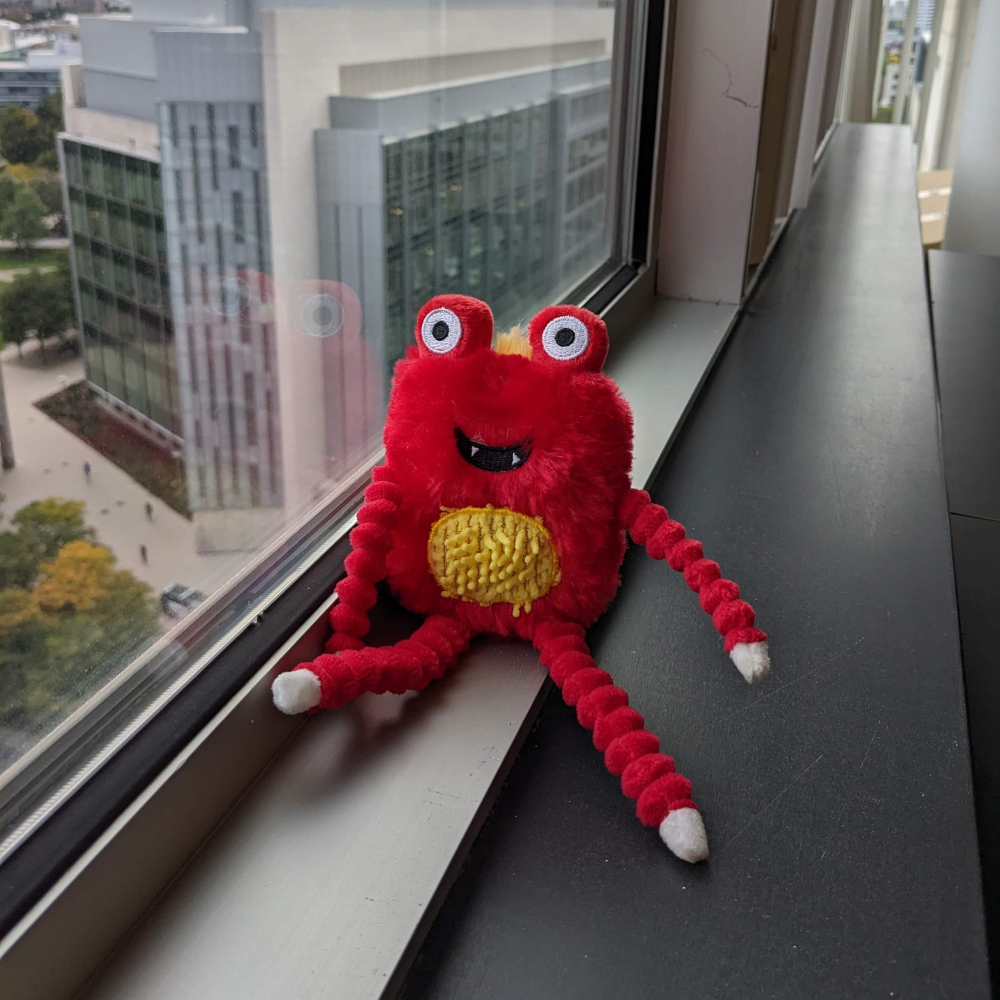

# Original training reference

`monster-toy-00.jpg` is an unchanged copy of Google DreamBooth's
`dataset/monster_toy/00.jpg`, photographed by **Varun Jampani**. It was one of four
training photographs in this LoRA experiment; `04.jpg` was held out. The displayed
file is the original 1440×1440 image. The training pipeline resized it to 1024×1024.

- [Pinned upstream image](https://github.com/google/dreambooth/blob/4f887af7970a06fc0cd3adaa1d0b368547d6a1d0/dataset/monster_toy/00.jpg)
- [Upstream attribution](https://github.com/google/dreambooth/blob/4f887af7970a06fc0cd3adaa1d0b368547d6a1d0/dataset/references_and_licenses.txt)
- License: **Creative Commons Attribution 4.0 International**, [included text](LICENSE.md), [upstream license](https://github.com/google/dreambooth/blob/4f887af7970a06fc0cd3adaa1d0b368547d6a1d0/LICENSE.md).
- Original-file SHA256: `8138db18ca07bb93126a9de4a4aaf18ee2f3168f90f7e2525fd16edba386d346`.

The photograph retains its CC BY 4.0 license; the repository's MIT code license
does not replace it. No cropping, retouching or recompression was applied to this
copy. The README display width only changes how it is shown on the page.

[Return to the training progression](../README.md#learning-one-subject-over-1000-updates).
