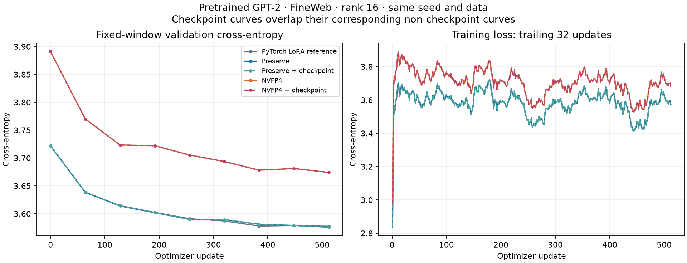
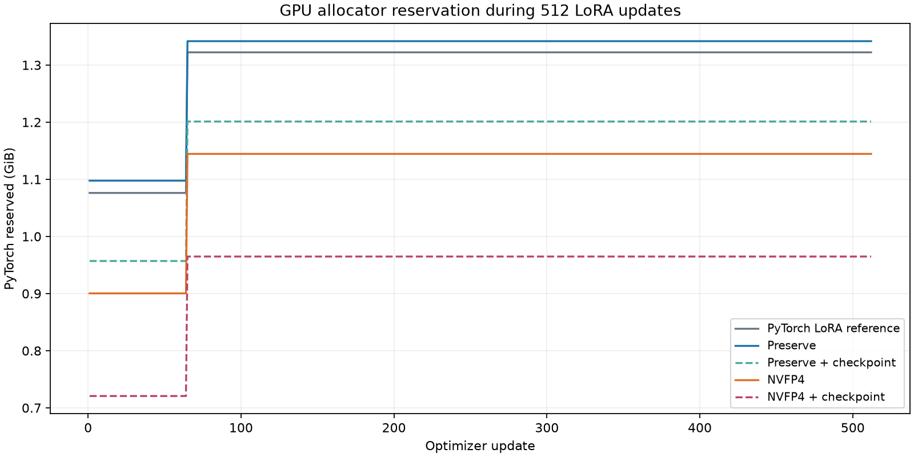

# LoRA measurements

RTX 5060 Ti 16GB; WSL Ubuntu 22.04, PyTorch 2.11.0+cu130. Tests run on 2026-11-09. The independent preserve package was also GPU-tested on Windows with PyTorch 2.14.1+cu132.

The later [official Transformer Engine default comparison](../official-te-20261113/README.md)
uses these unchanged archives as baselines. It retains all 12 workload combinations,
the official 2×512 graph speed win, both 512-step GPT-2 losses, and separate
construction/capture/training memory measurements. This page remains the original
project experiment record.

All comparisons train both LoRA matrices at rank/alpha 16, with FP32 adapters and fused AdamW state, BF16 base storage for the reference/preserve paths, lr 2e-4, betas (0.9, 0.999), eps 1e-8 and no weight decay. The reference is the ordinary two-linear PyTorch LoRA expression, not a claim about every PEFT implementation.

## Full training steps

12 warmup steps, three rounds of 20 synchronized measurements. Forward, loss, backward and AdamW are included. Graph timings also include copying the already-GPU-resident batch into static inputs. Compilation and capture are excluded from time.

The memory columns below include the largest allocated/reserved peak observed during construction, warmup or capture, not just replay. Replay-only allocated peaks can undercount graph-pool memory; the JSON keeps both.

| Base / batch×sequence | Mode | Graph ms/step | Tokens/s | Speed vs reference | Peak allocated GiB | Peak reserved GiB |
|---|---|---:|---:|---:|---:|---:|
| 453.1M / 2×64 | PyTorch LoRA reference | 10.52 | 12,168 | 1.00× | 1.166 | 1.275 |
| 453.1M / 2×64 | Preserve | 10.47 | 12,228 | 1.00× | 1.169 | 1.271 |
| 453.1M / 2×64 | Preserve + checkpoint | 14.65 | 8,739 | 0.72× | 1.059 | 1.148 |
| 453.1M / 2×64 | NVFP4 | 9.04 | 14,165 | 1.16× | 0.886 | 1.291 |
| 453.1M / 2×64 | NVFP4 + checkpoint | 11.45 | 11,179 | 0.92× | 0.890 | 1.186 |
| 453.1M / 2×512 | PyTorch LoRA reference | 53.14 | 19,270 | 1.00× | 1.947 | 2.998 |
| 453.1M / 2×512 | Preserve | 49.95 | 20,499 | 1.06× | 1.947 | 3.021 |
| 453.1M / 2×512 | Preserve + checkpoint | 78.19 | 13,096 | 0.68× | 1.171 | 1.352 |
| 453.1M / 2×512 | NVFP4 | 32.03 | 31,974 | 1.66× | 1.589 | 2.607 |
| 453.1M / 2×512 | NVFP4 + checkpoint | 39.75 | 25,764 | 1.34× | 0.890 | 1.295 |
| 50.4M / 1×257 | PyTorch LoRA reference | 2.90 | 88,575 | 1.00× | 0.206 | 0.264 |
| 50.4M / 1×257 | Preserve | 2.66 | 96,697 | 1.09× | 0.203 | 0.266 |
| 50.4M / 1×257 | Preserve + checkpoint | 3.69 | 69,725 | 0.79× | 0.173 | 0.240 |
| 50.4M / 1×257 | NVFP4 | 2.40 | 106,914 | 1.21× | 0.171 | 0.275 |
| 50.4M / 1×257 | NVFP4 + checkpoint | 3.37 | 76,163 | 0.86× | 0.136 | 0.230 |

Ordinary eager execution can be substantially slower, especially for small matrices: Python launch overhead remains. The raw report includes every eager result. Preserve gives a modest gain over the matched graph reference; its larger memory saving comes from optional activation checkpointing. FP4 benefits depend on shape and can disappear on smaller or heavily padded workloads.

## Real pretrained-model adaptation

The local pretrained GPT-2 checkpoint has 124,439,808 parameters. Conv1D weights are transposed into ordinary Linear modules. A separate FP32 CPU comparison against Transformers gives relative logits error 1.60e-7 (maximum 6.10e-5). Causal SDPA and zero dropout are used in every mode. The embedding and tied vocabulary head remain BF16 and frozen.

512 updates, batch 2, sequence 256: 262,144 training tokens. Validation uses the same 16 batches (8,192 prediction tokens), held out from training. Source checksums, seed, full traces and configuration are in [fineweb.json](fineweb.json).

| Mode | Validation before | Validation at 512 | Difference vs reference at 512 | Mean ms/update | Peak allocated GiB | Peak reserved GiB |
|---|---:|---:|---:|---:|---:|---:|
| PyTorch LoRA reference | 3.72177 | 3.57737 | +0.00000 | 14.88 | 0.778 | 1.377 |
| Preserve | 3.72177 | 3.57578 | -0.00159 | 14.35 | 0.771 | 1.342 |
| Preserve + checkpoint | 3.72177 | 3.57578 | -0.00159 | 17.47 | 0.617 | 1.201 |
| NVFP4 | 3.89099 | 3.67412 | +0.09675 | 13.32 | 0.696 | 1.314 |
| NVFP4 + checkpoint | 3.89099 | 3.67412 | +0.09675 | 15.58 | 0.568 | 1.178 |

The FP4 validation gap decreased from about +0.1692 before adaptation to +0.0968 at 512 updates. It did not disappear. This is one seed on one pretrained model and dataset; it does not establish downstream quality for other models. Every run preserved all frozen weights/buffers bitwise and ended with finite adapter parameters. Checkpointed and uncheckpointed variants have identical recorded training and validation losses within each mode.

## Profiling and validation

The profiler confirms native `cutlass3x_sm120...ue4m3xe2m1` FP4 GEMMs, software SR and H16 RHT. Frozen base weights are encoded only during conversion. The per-step work is activation/gradient encoding, base GEMMs, low-rank GEMMs, attention/norms and adapter AdamW. Keeping one capture stream also avoids retaining a new cuBLAS workspace on every recapture. Packing releases each original projection immediately to bound conversion memory.

The tests cover 9 dtype/shape forward-and-gradient cases, a double-precision finite-difference check, 64 continuous optimizer steps per mode, exact resume, clipping, accumulation, explicit merge, tied-head exclusion and 16 paired SR seeds on both aligned/padded shapes. Graph updates agree bitwise with eager updates in the tested cases; capture and warmup add zero optimizer steps.

During development, a retained autograd graph caused a capture-stream error; detaching the retained loss and using the same warmup/capture stream fixed it. AdamW capture flags are now managed and restored. A scalar-buffer hashing bug in the test recorder was fixed before the FP4 language-model runs; the completed reference/preserve traces were retained unchanged. No failed training trace was omitted or relabeled as successful.

Files: [bench.json](bench.json), [fineweb.json](fineweb.json), [checks.json](checks.json), [Windows checks](windows-checks.json). See [the API guide](../../docs/LORA.md).
