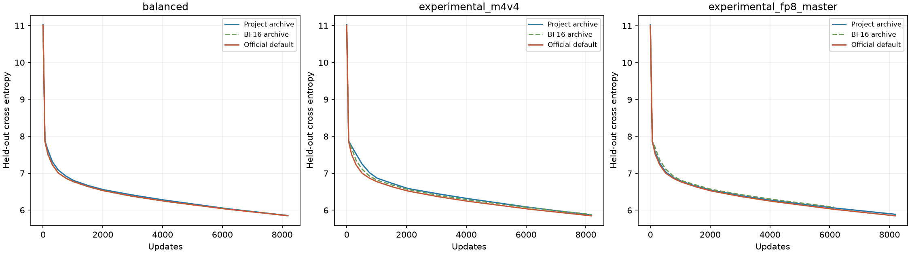
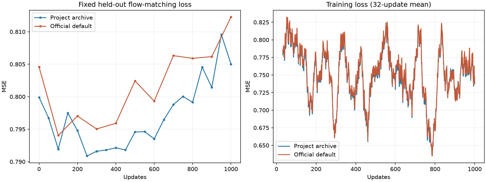

# Official Transformer Engine NVFP4 comparison — 2026-11-13

The project uses NVFP4 to improve training throughput, reduce memory use and make
larger workloads practical through selectable storage and recomputation policies.
Official TE now also executes RHT, stochastic rounding and native FP4 on the
tested SM120 GPU. This experiment measures the remaining implementation and
storage-policy differences on one **RTX 5060 Ti 16GB**.

**[Complete comparison tables](tables.md) · [Machine-readable results](comparison.json)
· [Evidence index and SHA256s](data-index.json)**

## Versions and experimental scope

| Component | Pinned version / record |
|---|---|
| Project baseline | [`e31a84233c0563a4c7b34305f5e41095b354b86f`](https://github.com/xl03-bit/sm120-nvfp4-training/tree/e31a84233c0563a4c7b34305f5e41095b354b86f), existing Git result archives |
| Official Transformer Engine | `2.22.0.dev0+464df759`, [`464df759d5a4ed549f2ce99b58fe653178a252f5`](https://github.com/NVIDIA/TransformerEngine/tree/464df759d5a4ed549f2ce99b58fe653178a252f5), main checked for this experiment |
| GPU / driver | RTX 5060 Ti 16GB, SM120 / 616.56 |
| Text / synthetic / GPT-2 environment | Separate WSL Ubuntu 22.04, Python 3.10.12, PyTorch 2.11.0+cu130, CUDA runtime 13.0, cuDNN 9.19.0.56, cuBLAS 13.1.0.3, TorchAO 0.17.0, Triton 3.6.0 |
| Image environment | Separate WSL environment, Python 3.10.12, PyTorch 2.14.1+cu132, torchvision 0.29.1+cu132, CUDA runtime 13.2, cuDNN 9.24.0.43, cuBLAS 13.4.1.3, diffusers 0.40.0, transformers 5.16.1, accelerate 1.15.0, NumPy 2.2.6 |
| Build toolchain | CUDA Toolkit 13.0.88. Both environments use the same unmodified TE core binary; the image PyTorch binding was rebuilt for its PyTorch version. |

The official commit includes the SM120 changes
[`17702596`](https://github.com/NVIDIA/TransformerEngine/commit/17702596) (RHT, #3300),
[`fc1fc0e7`](https://github.com/NVIDIA/TransformerEngine/commit/fc1fc0e7) (software SR, #3281),
[`2cd2257e`](https://github.com/NVIDIA/TransformerEngine/commit/2cd2257e) (SR in fused RHT, #3706),
and [`4a3a8a8e`](https://github.com/NVIDIA/TransformerEngine/commit/4a3a8a8e) (RHT dispatch, #3669).
This is a pinned development revision, not a claim that every earlier release
has the same behavior. A retained TE 2.21 diagnostic failed its RHT path; it is
not the version used for the performance tables.

Project baselines are the existing archives, as requested by the project owner.
No new project runs were used to replace them. The short full-parameter table is
explicitly the original pre-fix archive, not a fresh measurement of current HEAD.
Earlier original-implementation diagnostic runs made before this scope was
clarified remain in the local delivery but are not comparison baselines here.
No driver, firmware, clock, security setting or reboot changes were made.

## Primary comparison: official defaults, without custom tuning

- `NVFP4BlockScaling()` with default H16 RHT, backward stochastic rounding and
  16×16 shared weight scaling. TE kernel sources were not modified for performance.
- Full-parameter training: ordinary FP32 parameters and gradients, official
  FusedAdam FP32 first/second moments; original AdamW hyperparameters
  `lr=1e-4`, `betas=(0.9,0.999)`, `eps=1e-8`, `weight_decay=0.01`.
  `capturable=True` preserves the existing CUDA Graph timing method.
- LoRA: original BF16 frozen base, FP32 rank/alpha-16 adapters and fused PyTorch
  AdamW. The low-rank branch remains the ordinary two-linear expression. Original
  block checkpointing is retained when the workload requests it.
- No project compressed weight/master/moment storage, custom transpose
  recomputation or persistent quantized-weight cache is added to the official
  default path. No official configuration search was performed.
- Only required integration is applied: replacing the existing linear calls,
  internal 32-element alignment padding/cropping, preserving shared weights and
  the original BF16 autocast boundary. The architecture, logical vocabulary,
  model size, batch and original attention implementation remain intact.

The first GPT-2 attempt exposed an FP32 LayerNorm output entering the official
RHT path. Explicitly applying the existing BF16 autocast boundary at the linear
entry corrected the integration; LayerNorm precision and RHT were not changed.
The failed attempt and diagnosis are retained in the evidence index.

This is a comparison of complete implementations and their storage policies.
Time/memory differences include quantization, cached representations, parameter
precision and optimizer state; they cannot all be attributed to FP4 GEMM. It
does not establish the fastest or smallest configuration possible with TE.

## Complete training and evaluation conditions

| Workload | Retained protocol |
|---|---|
| 453M synthetic | 16 layers, width 1536, 12 heads, 2×64 positions, bidirectional attention and MSE; 12 warmups + 5×30 synchronized complete updates; median round wall time |
| FineWeb 354M short | 24 layers, width 1024, 16 heads, 2×512, tied 50257 vocabulary, causal SDPA; same short timing method, seed 2031 |
| FineWeb 8192 | Seed 1234, 8,388,608 training tokens, 64 fixed validation windows, unchanged evaluation checkpoints; final 6144→8192 segment for speed |
| Synthetic LoRA | Shapes B×T×D×layers = 2×64×1536×16, 2×512×1536×16 and 1×257×1024×4; checkpoint off/on, eager/graph; 12 warmups + 3×20 updates, synchronized step mean; lr 2e-4 |
| GPT-2 LoRA | Pretrained 124M, 2×256, 512 updates, checkpoint off/on, 16 fixed validation batches; speed excludes first 12 updates |
| FLUX | Original 1024px cached latents/text, batch 1, 98 projections, 23,887,872 FP32 trainable parameters, rank/alpha 16, checkpointing, cuDNN SDPA, fused AdamW, lr 1e-4, clip norm 1; original image/noise/timestep schedule |

Timings include forward, loss, backward and optimizer work; FLUX also includes
gradient clipping, and graph timings include copying the already-GPU-resident
batch into static inputs. Loading, compilation and graph construction are not
training throughput. Scheduled validation/checkpointing is excluded from update
time. Text tokens/s count batch×sequence positions; image throughput is images/s.

Train/validation window hashes match for the FineWeb comparisons. All 1000 FLUX
image/timestep indices were compared with the archive. Each completed official
run retained finite training losses; the saved FLUX adapter and all 196 Adam
states were finite at update 1000, and its frozen-base hashes matched.

## Findings, including official wins

For the `balanced` full-parameter baselines, default official time was about
**3.20×** the project archive on 453M and **1.76×** on the last segment of the
8192-update FineWeb run. Peak allocated memory was **6.896 versus 2.049 GiB**
and **5.844 versus 2.697 GiB**, respectively. The auxiliary compressed-storage
runs narrow these gaps; the storage implementation is part of the result.

The official **2×512, no-checkpoint LoRA graph** row was **1.9% faster**. The
other eleven LoRA combinations were slower, and the official allocation peaks
were higher. The [tables](tables.md#lora-all-12-workload-combinations) include
every eager/graph and checkpoint combination, with all-stage memory separately
from post-warmup training memory.

FLUX 40-update means were **2.383208 s official versus 2.305516 s project cache**;
official peak allocation was **9.732 versus 6.626 GiB**. Official NVFP4 was also
faster than the project's archived **BF16** control, **3.404774 s/update**.

Over 970 shared post-warmup FLUX long-run indices, official mean time was
**0.35% lower**, but median time was **0.55% higher**. The project archive
already documents a live preview overlapping updates **568–601**. Keeping the
970-index result and additionally excluding that same interval from both runs
gives **936** samples: **2.307914 s project versus 2.366685 s official**, or
**2.55% higher official mean time**. This secondary view is CPU analysis of saved
records, not another training run; no interval was selected by its measured speed.
Both views and their exact indices remain in [comparison.json](comparison.json).
Neither is a repeated-run causal comparison of a sub-percent speed difference.

Final validation values (project → official) were:

- FineWeb balanced, 8192 updates: **5.852692 → 5.848919 CE**, difference **−0.003773**.
- GPT-2 LoRA, 512 updates, both checkpoint settings: **3.674122 → 3.704230 CE**,
  difference **+0.030108**.
- FLUX, 1000 updates: **0.805012 → 0.812247 flow MSE**, difference **+0.007235**.

These are single-seed results. The official GPT-2 loss improved from its own
initial value, while both FLUX implementations ended with higher heldout MSE
than at initialization. Finite training does not imply monotonic validation
improvement, and this denoising objective does not directly measure subject
identity or generated-image quality. No official image-generation quality
comparison was performed.



The same single default official curve is shown against each of the three
project profiles. The FP8-master BF16 archive lacks a finite final endpoint;
the dashed curve stops where the archive stops.



## Actual OOMs and unsupported exact policies

**4.06B:** the complete 4,063,797,760-parameter model was constructed. Default
FP32 Adam-state initialization then OOMed, before a training update. NVML peaked
at **15.906 GiB**. The project archive completed 2048 updates at **0.297981 s/update**,
**12.7478 GiB** allocated and **6.675278** final CE using its compact FP8-master,
4-bit-moment and transpose-recomputation configuration. Neither the five-step
capacity test nor the 2048-step official run has a successful official speed/loss.

**H3:** this was an actual **projection-storage allocation probe**, not a full
official H3 training attempt. BF16 storage for the 200 quantized projections
alone requires **35.889 GiB**, excluding other weights, activations and optimizer.
Allocation failed at `blocks.46.mlp.fc1`; NVML peaked at **15.912 GiB**. The
project's packed/H128/recompute path had completed 200 updates at about
**0.9707 s/update**, **12.38 GiB** allocated and heldout MSE **4.71838 → 4.59948**.

No smaller model, shorter sequence or custom CPU offload was substituted. These
failures demonstrate the capacity difference under the measured default storage
policy; they do not prove that all possible official configurations fail.
The project's six short-test transpose-recomputation rows and packed H128 image
path have no identical default-TE policy. The default-policy comparisons are
explicitly labeled, and exact-policy hybrid rows remain unsupported.

## Physical memory and comparison limits

NVML sampled whole-device resident usage every 20 ms, including memory outside
the PyTorch allocator and other GPU users. It is a sampled peak lower bound,
not isolated process usage. Original Git results have no corresponding NVML
archive; no historical whole-device value or difference is inferred.

The records retain `allocated`, `reserved`, CUDA `mem_get_info` and NVML.
Synthetic LoRA resets allocation peaks after warmup; construction/capture peaks
and reservations are therefore shown separately. Under WDDM/WSL, allocator
accounting can exceed physical VRAM. The OOM errors even contain an invalid
enormous process-usage field. Those raw messages are preserved, but a roughly
30 GiB allocator count is not presented as 30 GiB of physical VRAM on this card.

Image runs retain the model scale and training protocol but differ from the
archive in OS/Python and weight representation. Original image runs used
Windows/Python 3.11.16, NumPy 2.4.6 and Accelerate 1.14.0; the new WSL environment
used Python 3.10.12, NumPy 2.2.6 and Accelerate 1.15.0. The recorded PyTorch,
torchvision, diffusers, transformers and safetensors versions match. Official TE
dynamically quantizes the corresponding BFL BF16 source; the project consumes
the prequantized checkpoint payload with its H128 backward recipe. Initial losses
already differ. The optional image-environment TorchAO import warning was
retained; TorchAO is not used for these image weights or TE computation.

Historical and new runs were not simultaneous, randomized repeated trials.
Preserved environment metadata is the current retained environment state, not
proof of dependencies absent from a historical archive. No significance claim
or invented paired confidence interval is made.

## RHT, SR and native FP4 evidence

Both environments passed all four RHT/SR toggle combinations. Captured-graph
fixed-input quantization changes approximately 69,000 payload bytes between
replays with SR enabled, versus zero with SR disabled. The optimizer capture
check matched eager parameters and both moments exactly over four updates.

Actual forward, input-gradient and weight-gradient GEMM calls consumed
`NVFP4TensorStorage` with E2M1 data and E4M3 scales. Profiling a real 453M complete
update recorded **64 native FP4 launches in each of the three GEMM roles**.
CUPTI captured the loaded module; its matching kernel disassembly contains
`OMMA.SF.16864.F32.E2M1.E2M1.UE4M3.4X`. This confirms native FP4 execution,
not merely an enabled configuration flag.

The official RHT path currently serves column layouts for weight gradients.
Frozen LoRA bases do not need base-weight gradients, so enabling the recipe does
not mean that every frozen projection executes RHT. Norms, attention, losses,
optimizers and low-rank branches retain their other precisions. Nsight hardware
counters returned `ERR_NVGPUCTRPERM`; no utilization percentage is claimed and
no driver/security setting was changed.

## Auxiliary results and evidence reproduction

The earlier official-compute runs reused project compressed weights/optimizer
state. They are preserved in the [auxiliary tables](tables.md#auxiliary-compressed-storage-runs),
including twelve successful short runs, six unsupported remat rows and three
complete 8192-update curves. They must not be presented as the official default
training stack. Nothing was dropped because it favored the official implementation.

[data-index.json](data-index.json) maps each source-relative file to its checked-in
copy and SHA256 of its **original uncompressed bytes**. Large text/JSON files
are losslessly gzip-compressed. It includes raw losses/timings, NVML samples,
environment versions, source/binary audits, failures, diagnostic evidence and
the original benchmark scripts. Model weights, installed environments, trained
adapter checkpoints and loaded CUDA binaries remain in the original local
delivery rather than being redistributed in this result directory.

Regenerate and verify the tables without a GPU or third-party Python packages:

```bash
python results/official-te-20261113/render.py
```

This verifies all 98 archived files before writing `tables.md` and
`comparison.json`. It also checks full FLUX update counts, data-order alignment
and the explicit 970/936-index timing views. There is no new training in this
documentation update.

The [archived harness](harness/) is unchanged from the experiment. Its
[local reproduction notes](harness/README-reproduce.txt) describe the original
isolated environments and input locations. Those scripts retain that layout:
they expect the pinned project checkout under `project/` beside `measure.py`,
and the original external model/data locations. Restore that layout or explicitly
adapt paths into a fresh results directory before rerunning; they are evidence
of the executed experiment, not a portable one-command installer.

The original local delivery is `te-nvfp4-compare-20261113/` in the experiment
workspace and includes the complete HTML report, logs, profiles and trained
FLUX checkpoint. The primary/auxiliary distinction and all original measurements
remain unchanged; this publication adds explicit context for the already-known
FLUX preview overlap.
